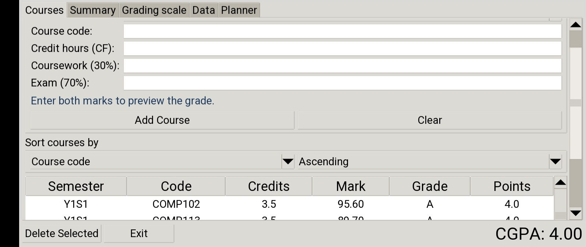
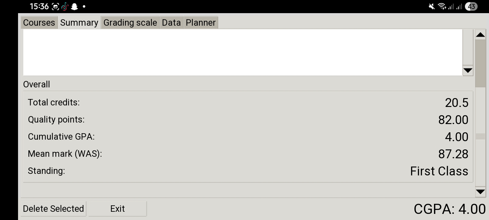
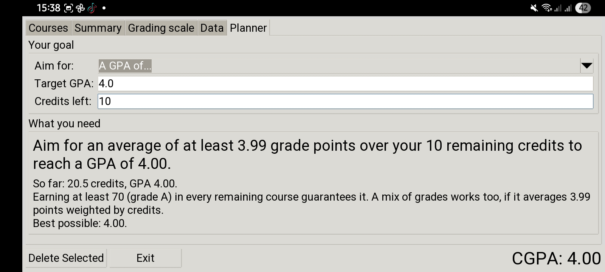

# GPA Tracker (showcase)

A personal desktop app that records course marks by semester and reports final marks, letter grades, GPA and degree class using the grading rules in Egerton University's 2020 regulations (section 16.4.1). The layout is designed for small phone screens. It is **not** an official university tool.

> **The source code is private.** This repository holds the documentation, architecture, screenshots and a short illustrative snippet. See [LICENSE](LICENSE).

**Status:** Completed (personal project, no users or deployment) · **Stack:** Python 3.8+, Tkinter/ttk, SQLite (`sqlite3`), `decimal`, `unittest`

## Screenshots

| Add a course | Results and degree class | "What do I need?" planner |
|---|---|---|
|  |  |  |

## What it does

- 30/70 coursework-exam weighting, A to F grade bands, credit-weighted GPA, degree class and a discontinuation-risk rule.
- Edit-in-place for saved courses, keeping each record's id and date added.
- Dated, integrity-checked database backups and a CSV export that opens in Excel and Google Sheets.
- Plain-language messages instead of raw crashes when the database file is corrupt, locked, read-only or missing.
- A planner that works out the average needed on the remaining credits to reach a target class or GPA.

## The problem it solves

Class boundaries are decided on a rounded mean, so a raw 59.995 already counts as 60. Floating-point numbers and banker's rounding can get cases like that wrong, so the app calculates with exact decimals and half-up rounding (see [snippets](snippets/round_half_up.py)).

## Design in one paragraph

Twenty-one application modules (about 2,400 lines). Grading, validation, regrading, planning, sorting, exporting and error logic are free of GUI code; SQL lives only in `database.py`; each tab has a thin Tkinter mixin. A test enforces that the logic modules never import `tkinter`. See [docs/architecture.md](docs/architecture.md).

## Bugs found and what they taught me

1. **Year 1 also matched Year 10.** A prefix check (`startswith("Y1")`) also matched `Y10S1`. Fixed by matching `Y1S`, plus a regression test. *Boundary tests find assumptions ordinary examples never touch.*
2. **Grades went stale.** Final marks were stored at entry time and never recalculated. The saved coursework and exam marks became the source of truth, grades are derived on every read, and a start-up repair rewrites stored values in one transaction after a verified backup. *Keep inputs, derive the rest.*
3. **Back Up Now could freeze.** SQLite's backup call retries forever when the source is locked. A progress callback now gives up and reports a clear message. *Test failures with real faults, and make hang tests able to time out.*
4. **The planner could advise failing.** For low targets the required average was correct but only reachable by failing courses. A "passing every course is enough" outcome was added. *A correct calculation can still give bad advice.*

## Testing and evidence

- **564 automated checks:** 193 unit tests and 371 window-level checks run against a stand-in for Tkinter.
- **Mutation testing:** 89 deliberately planted bugs, all caught.
- **Not tested:** the layout has not been tried on a real phone.

## Source access

The code is private. I am happy to walk through it or demonstrate the app on request.
