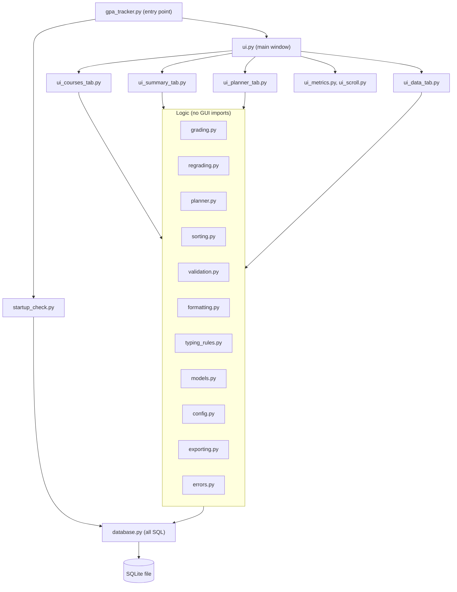

# GPA Tracker: architecture

Three layers. The UI never calculates; the logic never imports `tkinter`; SQL lives in one module.

## Modules (21)

| Group | Modules |
|---|---|
| Entry and start-up | `gpa_tracker`, `startup_check` |
| Interface | `ui`, `ui_courses_tab`, `ui_summary_tab`, `ui_planner_tab`, `ui_data_tab`, `ui_metrics`, `ui_scroll` |
| Rules and calculation | `grading`, `regrading`, `planner`, `sorting`, `validation`, `typing_rules`, `formatting`, `config`, `models` |
| Storage and output | `database`, `exporting` |
| Errors | `errors` |

## Tests

One test module per area (backup, changes, database, edit, errors, grading, planner, planner tab, pure helpers, regrade, sorting, validation) plus a runner. A small stand-in for Tkinter lets the window-level checks run without a display.

## Why it is split this way

- The grading rules can be tested exhaustively without a window.
- Because grades are derived from saved marks, changing the configuration cannot leave old records inconsistent.
- Keeping SQL in one place made the error translation (corrupt, locked, read-only, missing file) a single layer.
